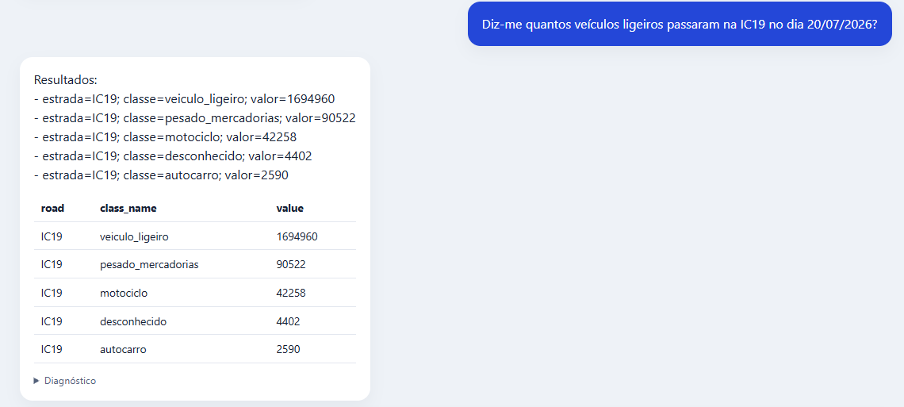
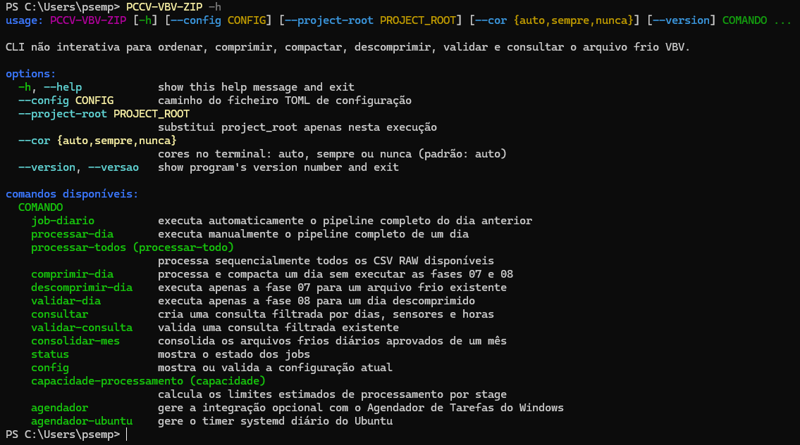
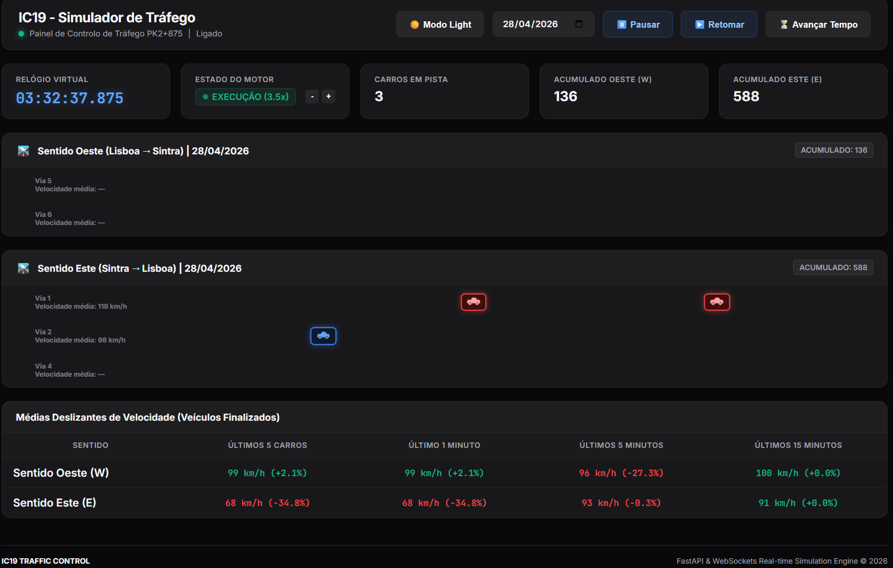

# Pedro Jesus

**Software Developer & Computer Engineering Student | Lisbon, Portugal**

I build practical software for real-world problems, with a focus on backend systems, web applications, AI integration and data processing.

---

## About me

I completed a **CTeSP in Software Development at ISTEC Lisboa** and a software development internship at **Infraestruturas de Portugal**. I am currently pursuing a **Bachelor's degree in Computer Engineering at ISTEC Lisboa**.

My main interests are backend development, web applications, artificial intelligence and data processing. I enjoy understanding how systems work and turning complex requirements into practical, maintainable software.

---

## Tech stack

### Programming

  
  &nbsp;&nbsp;
  
  &nbsp;&nbsp;
  
  &nbsp;&nbsp;
  

Python · JavaScript · C# · Kotlin

### Backend & Web

  
  &nbsp;&nbsp;
  
  &nbsp;&nbsp;
  

FastAPI · HTML · CSS

### AI

  
  &nbsp;&nbsp;
  

Ollama · Qwen

### Data

  
  &nbsp;&nbsp;
  
  &nbsp;&nbsp;
  
  &nbsp;&nbsp;
  

SQL · MySQL · DuckDB · ClickHouse

### Tools

  
  &nbsp;&nbsp;
  
  &nbsp;&nbsp;
  
  &nbsp;&nbsp;
  

Git · GitHub · Linux · Jupyter

---

## Featured projects

### 01 — AI Traffic Queries

A web application for querying traffic and sensor data through natural language using an existing Qwen model, Ollama and ClickHouse. I developed the web application, backend, frontend and integration layer; I did not develop or train the model.

**Source code:** private repository 
**Case study:** [View AI Traffic Queries](https://pedrojesus32.github.io/#/projects/ai-traffic-queries)

### 02 — Sensor Data Compression

A Python workflow for lossless traffic sensor data compression, decompression, integrity validation and data queries.

**Source code:** not currently linked to this profile 
**Case study:** [View Sensor Data Compression](https://pedrojesus32.github.io/#/projects/sensor-data-compression)

### 03 — Traffic Simulator

A web-based traffic simulator for visualising vehicle movement, controlling simulations and monitoring traffic indicators through a responsive interface.

**Source code:** private repository 
**Case study:** [View Traffic Simulator](https://pedrojesus32.github.io/#/projects/traffic-simulator)

---

## Connect with me

  
  

